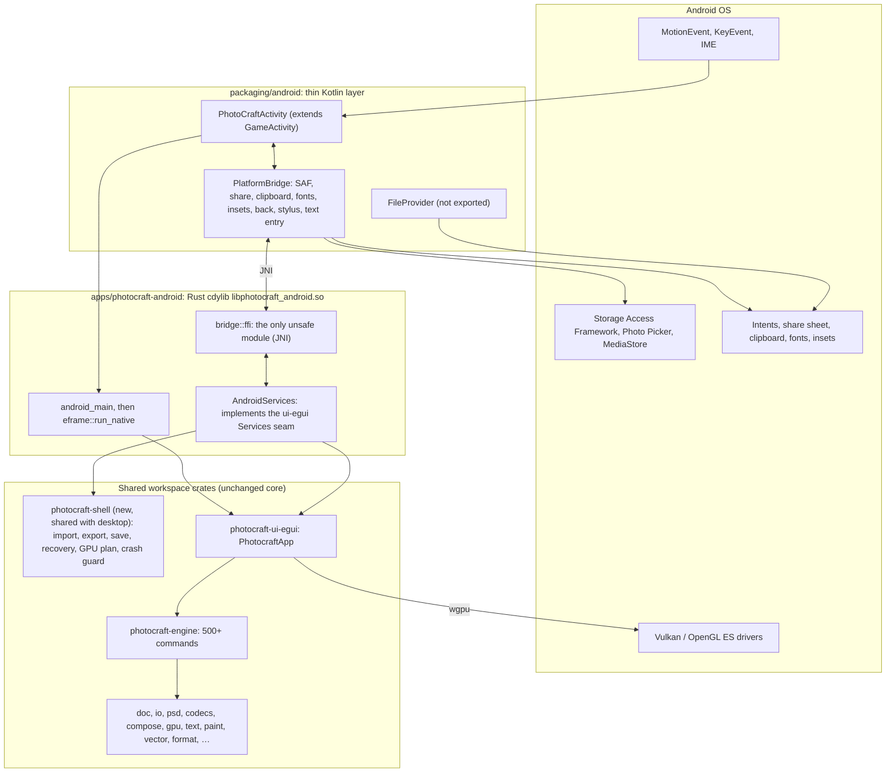
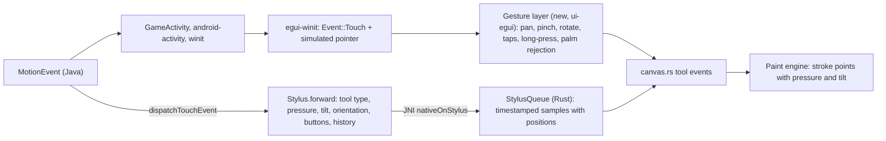

# 04: Technical architecture and solution design

| | |
|---|---|
| **Version** | 1.0 draft, 2026-10-13 |
| **Audience** | Implementer and reviewer agents ([11](11-ai-delivery-plan.md)), the owner, and upstream maintainers |
| **Status** | Proposed. Phase 0 validates every item marked **[verify]** before G0 |

The code snippets are **illustrative**. They show the intended shape, not a finished implementation. Check exact APIs
against the crate and AndroidX documentation of the pinned versions in Phase 0.

---

## 1. Baseline technology (upstream at `2d5a749`)

| Component | Version | Android relevance |
|---|---|---|
| Rust | edition 2024, `rust-version = "1.95"` | `aarch64-linux-android` and `x86_64-linux-android` are Tier 2 targets with a prebuilt standard library from rustup (cross-compiled from desktop hosts) |
| eframe / egui / egui-winit / egui-wgpu | 0.36.2 | eframe runs on Android with `NativeOptions::android_app` and the `android-game-activity` (or `android-native-activity`) feature |
| winit | 0.30.13 (pinned exactly by the desktop app on Linux) | Android backend through `android-activity` |
| android-activity / ndk / jni | 0.6.1 / 0.9.0 / 0.22.4 (already in `Cargo.lock`) | GameActivity glue; NDK bindings; JNI calls |
| wgpu | 30.0.1 (`crates/gpu`: `default-features = false`, `std` and `wgsl`) | Vulkan and GLES (EGL, `khronos-egl` 6.0) backends; both must be compiled in for Android **[verify feature unification]** |
| accesskit / accesskit_winit | 0.24.1 / 0.32.2 | No Android adapter in the lockfile, so no TalkBack in v1 (NFR-A11Y-05). The `accesskit` feature must at least compile for Android **[verify]** |
| rfd, arboard, open | desktop-only (behind `cfg(not(wasm32))` in `apps/photocraft`) | Not used on Android. Their jobs move to the bridge |
| Codecs and parsers | heic-rs 0.1.4, zune-jpeg 0.5, png 0.18, tiff 0.11, exr 1.73, image-webp, ruzstd, flate2 (Rust backend), blake3 (`pure`), resvg 0.45, wasmi 2.0 | Pure Rust, so the NDK linker is all they need |
| craft-print (craft-libs) | pinned rev | `cfg(unix)` uses CUPS `lp`, which compiles but fails at run time on Android. Hide Print (FR-FEAT-02) |

**Workspace rules that shape the design** (from upstream `AGENTS.md`):

- Strict layers (L0–L6, checked by `cargo xtask layers`).
- No `unsafe` outside one isolated helper crate (`crates/tablet`).
- No panics in non-test code.
- Never break WebAssembly; file-system code goes through platform services.
- No webview shells.
- The UI is thin; all actions are engine commands.

---

## 2. Solution overview



**Principles**

1. **Rust owns the behaviour.** Kotlin only translates Android framework calls and callbacks: it starts system
   pickers, opens file descriptors, posts events and reads stylus axes. It holds no document state and makes no UI
   decisions.
2. **Reuse the platform seam.** The Android shell implements `photocraft_ui_egui::Services`. Additions to that seam
   are small, optional fields that desktop and web leave unset (UC-04).
3. **Share shell code with desktop.** The platform-independent parts of `apps/photocraft/src` move into a shared
   crate, so desktop and Android do not drift (UC-02). Candidates: import, export and the save worker; recovery
   wiring; the GPU crash-marker logic; the crash guard; the logging core; the control server.
4. **Everything Android-specific sits behind `cfg(target_os = "android")`.** On desktop hosts the app crate compiles
   to an empty library, as `photocraft-web` does for non-wasm targets, so workspace-wide builds and tests keep
   working.

---

## 3. Repository layout (proposed, upstream)

```text
apps/photocraft-android/            # Rust: the Android shell (cdylib)
  Cargo.toml
  src/lib.rs                        # crate docs, lints, cfg gate
  src/android/mod.rs                # android_main, eframe start-up
  src/android/services.rs           # AndroidServices: builds photocraft_ui_egui::Services
  src/android/storage.rs            # app dirs, TMPDIR check, recovery, prefs and presets paths
  src/android/documents.rs          # SAF requests and replies, fd reading and writing, recents, display names
  src/android/gpu.rs                # backend plan (Vulkan, then GLES, then CPU canvas) and crash marker
  src/android/lifecycle.rs          # pause/resume, autosave flush, trim-memory, exit reasons
  src/android/input.rs              # stylus sample queue, back, insets, text-entry fallback
  src/android/fonts.rs              # system font list, CJK fallback registration
  src/android/bridge/mod.rs         # safe, typed API over JNI (Result everywhere)
  src/android/bridge/ffi.rs         # the ONLY module with #[allow(unsafe_code)]: exports and fd ownership
  tests/                            # host-run tests of the pure mapping code (MIME, names, versionCode, tilt)
packaging/android/                  # Gradle project
  settings.gradle.kts  build.gradle.kts  gradle/libs.versions.toml  gradlew  gradle/wrapper/*
  app/build.gradle.kts  app/proguard-rules.pro
  app/src/main/AndroidManifest.xml
  app/src/main/kotlin/ai/storyteller/photocraft/
      PhotoCraftActivity.kt  PlatformBridge.kt  Documents.kt  Share.kt  Clipboard.kt
      Fonts.kt  Insets.kt  Stylus.kt  TextEntry.kt  ExitReasons.kt
  app/src/main/res/                 # adaptive icon (from assets/app-icon/photocraft.svg), splash theme,
                                    # xml/file_paths.xml, xml/locales_config.xml, xml/data_extraction_rules.xml,
                                    # xml/backup_rules.xml, xml/shortcuts.xml (Safe GPU mode)
  app/src/qa/AndroidManifest.xml    # QA build type: INTERNET for the loopback control server only
  app/src/{release,qa,debug}/jniLibs/   # per-build-type .so files written by package.sh (git-ignored)
  package.sh                        # cargo ndk, Gradle, verification, renaming, checksums
  smoke.sh                          # emulator smoke test through the control channel
crates/shell/ (photocraft-shell, new L7) # shared by apps/photocraft and apps/photocraft-android (UC-02)
xtask/src/android.rs                # cargo xtask android {check,build,run,test,size}
.github/workflows/android.yml       # PR gate, QA APK, emulator smoke (see 06 §5)
docs/android.md                     # build, run, debug, release
```

---

## 4. Toolchain and build configuration

### 4.1 Versions to pin (in Phase 0)

| Tool | Requirement |
|---|---|
| Rust | Workspace toolchain (≥ 1.95), plus `rustup target add aarch64-linux-android x86_64-linux-android` |
| Android NDK | r28 or newer (r28+ aligns ELF segments for 16 KB pages by default); pin the exact revision |
| Android SDK | Platform 36, build-tools 36.x, platform-tools |
| JDK | 17 (required by AGP 8.x) |
| AGP and Gradle | A current stable AGP that supports compileSdk 36, with the matching Gradle wrapper (committed) |
| cargo-ndk | Pinned version, installed with `cargo install --locked` |
| AndroidX GameActivity | **The exact version `android-activity` 0.6.1's bundled C glue expects** (read from its README or CHANGELOG). A mismatch crashes at start-up **[verify]** |

### 4.2 Cargo configuration

```toml
# .cargo/config.toml (additions). Google Play requires 64-bit libraries aligned for 16 KB pages
# (apps targeting Android 15+). NDK r28+ already defaults to it; the flag keeps other linkers correct.
# Note: a RUSTFLAGS environment variable replaces these target rustflags, so CI must not set one globally.
[target.aarch64-linux-android]
rustflags = ["-C", "link-arg=-Wl,-z,max-page-size=16384"]

[target.x86_64-linux-android]
rustflags = ["-C", "link-arg=-Wl,-z,max-page-size=16384"]
```

```toml
# Cargo.toml (workspace): Android release profile. Release speed, with line tables kept so Play
# and tombstones can be symbolicated (AGP strips the packaged copy and uploads the symbols).
# panic stays "unwind": the shell's crash guard needs it (AGENTS.md › Never crash).
[profile.android-release]
inherits = "release"
debug = "line-tables-only"
strip = "none"
```

### 4.3 The app crate manifest (sketch)

```toml
[package]
name = "photocraft-android"
description = "PhotoCraft on Android: GameActivity shell (eframe), Android Services and the JNI bridge"
version.workspace = true
edition.workspace = true
license.workspace = true
publish = false

[lib]
name = "photocraft_android"          # libphotocraft_android.so; matches android.app.lib_name
crate-type = ["cdylib", "lib"]

[features]
heif = ["photocraft-codecs/heif"]     # official builds enable it, as on desktop
control = []                          # QA builds only: loopback control server (FR-QA-01)

# Like crates/tablet: `unsafe` is denied crate-wide and allowed only in src/android/bridge/ffi.rs
# (the android_main export and fd ownership), each block with a SAFETY: comment.
# The workspace's `forbid` cannot be relaxed per item, so this crate does not inherit workspace lints.
[lints.rust]
unsafe_code = "deny"

[lints.clippy]
dbg_macro = "warn"
todo = "warn"

[dependencies]
photocraft-ui-egui = { workspace = true }
photocraft-engine  = { workspace = true }
photocraft-shell   = { workspace = true }   # UC-02
egui = { workspace = true }
log  = { workspace = true }
serde_json = { workspace = true }

[target.'cfg(target_os = "android")'.dependencies]
eframe = { workspace = true, features = ["wgpu", "android-game-activity"] }
winit  = { version = "=0.30.13", default-features = false, features = ["android-game-activity"] }
jni    = "=0.22.4"                     # already in Cargo.lock
android_logger = "…"                  # pin exactly when added (reviewed dependency)
```

### 4.4 Entry point (sketch)

```rust
// src/android/mod.rs
use winit::platform::android::activity::AndroidApp;

/// Called once by android-activity on its native thread after GameActivity.onCreate.
// The export is the only reason for `unsafe` here: android-activity looks the symbol up by name.
// The body is safe code.
#[allow(unsafe_code)]
#[unsafe(no_mangle)]
pub fn android_main(app: AndroidApp) {
    logging::init();                                    // logcat "PhotoCraft" + rotating file log
    let dirs = storage::AppDirs::from(&app);            // internal_data_path, cache dir via bridge
    let plan = gpu::plan(&dirs);                        // reads the crash marker: Vulkan, then GLES, then CPU canvas
    let options = eframe::NativeOptions {
        android_app: Some(app.clone()),
        renderer: eframe::Renderer::Wgpu,
        wgpu_options: gpu::wgpu_options(&plan),
        persistence_path: Some(dirs.files.join("ui.ron")),
        ..Default::default()
    };
    let started = eframe::run_native("PhotoCraft", options, Box::new(move |cc| {
        let services = services::build(&app, &dirs, cc);  // AndroidServices, see §6
        Ok(Box::new(app_builder::build(cc, services, &plan)))
    }));
    if let Err(e) = started {
        log::error!("PhotoCraft could not start: {e}");   // no panic; the marker steers the next start
    }
}
```

### 4.5 Gradle (sketch, `app/build.gradle.kts`)

```kotlin
android {
    namespace = "ai.storyteller.photocraft"
    compileSdk = 36
    defaultConfig {
        applicationId = "ai.storyteller.photocraft"      // forks: their own id (D-01)
        minSdk = 29
        targetSdk = 36
        versionName = providers.gradleProperty("photocraftVersionName").get()
        versionCode = providers.gradleProperty("photocraftVersionCode").get().toInt()
        ndk { abiFilters += listOf("arm64-v8a", "x86_64") }
    }
    buildTypes {
        getByName("release") {
            isMinifyEnabled = true
            proguardFiles(getDefaultProguardFile("proguard-android-optimize.txt"), "proguard-rules.pro")
            ndk { debugSymbolLevel = "FULL" }
        }
        create("qa") { initWith(getByName("release")); applicationIdSuffix = ".qa" }
    }
    splits { abi { isEnable = true; reset(); include("arm64-v8a", "x86_64"); isUniversalApk = true } }
    packaging { jniLibs { useLegacyPackaging = false } }  // uncompressed, page-aligned .so
}
dependencies {
    implementation(libs.androidx.games.activity)     // exact version per §4.1
    implementation(libs.androidx.activity.ktx)       // ActivityResult contracts, OnBackPressedDispatcher
    implementation(libs.androidx.core.ktx)           // FileProvider, WindowInsetsCompat
    implementation(libs.androidx.core.splashscreen)
}
```

### 4.6 Build command

```sh
VERSION=$(cargo xtask version)                      # single source of truth (06 §3)
cargo ndk --platform 29 -t arm64-v8a -t x86_64 \
  -o packaging/android/app/src/release/jniLibs \
  build --profile android-release -p photocraft-android --features heif
(cd packaging/android && ./gradlew -PphotocraftVersionName="$VERSION" \
   -PphotocraftVersionCode="$(cargo xtask android version-code)" assembleRelease bundleRelease)
```

If the pinned cargo-ndk does not accept `--profile`, use `--release` with `CARGO_PROFILE_RELEASE_*` overrides
**[verify]**. Official builds also set `CRAFT_FONTS_DIR` when D-09 bundles the fonts.

---

## 5. Activity model and start-up

### 5.1 GameActivity or NativeActivity (D-04)

| Criterion | GameActivity | NativeActivity |
|---|---|---|
| Soft keyboard and IME | GameTextInput: text state synchronized with the IME (composition, deletion) | Key events only; many IMEs never send them |
| Java/Kotlin subclass | A normal AndroidX `AppCompatActivity` subclass (ActivityResult API, OnBackPressedDispatcher, insets) | Needs a Java subclass anyway to receive activity results |
| Build | Needs Gradle and a Maven dependency | No Java code strictly required |
| Support in the Rust stack | `android-activity` feature `game-activity`; eframe feature `android-game-activity` | Feature `native-activity` |
| **Verdict** | **Recommended**: we need Kotlin for SAF anyway, and IME support is decisive for the Type tool | Fallback only |

### 5.2 Start-up sequence

1. `PhotoCraftActivity.onCreate` sets `TMPDIR` to `cacheDir/tmp` with `android.system.Os.setenv`, **before**
   `super.onCreate` loads the native library.
   - Why: when `TMPDIR` is unset, Rust's `std::env::temp_dir()` returns `/data/local/tmp` on Android, which apps
     cannot write.
   - Why Kotlin: since edition 2024, `std::env::set_var` is `unsafe` in Rust, so setting the variable on the
     Kotlin side avoids an `unsafe` block.
2. The activity enables edge-to-edge, registers the back callback, installs the inset and stylus listeners, attaches
   `PlatformBridge`, and then calls `super.onCreate`. GameActivity loads `libphotocraft_android.so` and starts the
   native thread.
3. `android_main` initializes logging, reads `ApplicationExitInfo` through the bridge (FR-LC-05), builds the GPU plan
   from the crash marker (§10), and starts eframe.
4. The eframe app-creation callback builds `AndroidServices`, then `PhotocraftApp`. Preferences, presets and
   recovery entries load in the background, as on desktop.
5. When the first frame renders, the GPU start marker is cleared and the splash screen is dismissed.

---

## 6. `Services` mapping (the platform seam)

Field list as in `crates/ui-egui/src/lib.rs` at the baseline commit.

| `Services` field | Android implementation | Phase | Priority |
|---|---|---|---|
| `import`, `export`, `encode_png` | Reuse the desktop implementations, moved from `apps/photocraft/src/services.rs` into `photocraft-shell` (pure Rust) | P1 | Must |
| `save_file` | Worker thread: encode fully (desktop `ExportFn` path) into memory and a temp copy in `cacheDir/save/`; call `SaveCtl::commit`; then write the target through a bridge-opened descriptor (`openFileDescriptor(uri, "wt")`; plain `"w"` does not truncate on every provider); fsync; delete the temp copy only after success | P1 | Must |
| `write` | The same target-write path, for small synchronous writes (swatches, presets, history log export) | P1 | Must |
| `file_dialog` | `FileDialogRequest::Open { multiple, extensions }` maps to `OpenDocument` or `OpenMultipleDocuments` (MIME list derived from `extensions`, plus `*/*`); `Folder` maps to `OpenDocumentTree`; `Save { suggested }` maps to `CreateDocument(mime)` with the suggested title. Results arrive as a JNI callback, then `FileDialogReply::send`. File bytes are read on a worker from the descriptor and returned as `FileDialogAnswer::Contents` or `ContentsMany` (the variants the web build already uses), plus the document origin (UC-03). **As built (2026-10-15, `apps/photocraft-android/src/documents.rs`):** answers are `FileDialogAnswer::Located` (bytes plus location); `Reopen` serves Open Recent; `Folder` answers "not available yet" until WP 1.7. See §7.0 for how the bridge differs from this sketch | P1 | Must |
| `inbox` | `VIEW`, `EDIT`, `SEND` and `SEND_MULTIPLE` intents (including `onNewIntent`) and Photo Picker results are queued as (name, bytes, origin) | P1 | Must |
| `os_events` | Back (predictive back callback), open-documents, memory pressure, insets and configuration changes | P1 | Must |
| `load_prefs`, `save_prefs` | `filesDir/prefs.json`, written atomically (temp file plus rename) | P1 | Must |
| `preset_store` | `photocraft_engine::preset_store` rooted at `filesDir/presets` | P1 | Must |
| `autosave`, `autosave_results`, `discard_autosave`, `recover`, `adopt_autosave` | `photocraft_format::RecoveryStore` at `filesDir/recovery` (as desktop), plus an immediate flush on pause (FR-LC-04) | P1 | Must |
| `system_theme` | `Configuration.uiMode & UI_MODE_NIGHT_MASK`, refreshed on configuration change | P1 | Must |
| `open_url` | `Intent.ACTION_VIEW` to the default browser; no in-app web view | P1 | Must |
| `quit` | Called after the UI's unsaved-changes prompt: `finishAndRemoveTask()` | P1 | Must |
| `clipboard_set_image`, `clipboard_get_image` | `ClipboardManager` with a PNG in `cacheDir/clipboard` behind FileProvider; reading resolves the `ClipData` URI, then decodes | P1 | Should |
| `append_text` (History Log) | `filesDir/logs/history-log.txt`, plus "Export History Log" (share) | P2 | Could |
| `beep` | Haptic click or system notification sound through the bridge | P2 | Could |
| `automation_read`, `automation_write`, `automation_save`, `automation_open_pcraft`, `automation_command`, `automation_authorize` | QA build only, behind the `control` feature; `None` in release | P1 | Must (QA) |
| `read_displays` | v1 returns nothing (canvas in sRGB). Later: wide-gamut and HDR display information | — | Won't (v1) |
| `screen_pick` | Sampling outside the app window would need MediaProjection: `None`. In-canvas sampling is unaffected | — | Won't |
| `photoshop_shortcuts` | No Photoshop install on Android: `None` | — | N/A |
| `cursor_pos`, `caps_lock`, `window_frame`, `caption_style`, `native_menu`, `is_wayland`, `xwayland_command` | Desktop window-system concerns: `None` or `false`. The shell also sets `PhotocraftApp::custom_titlebar = false`, so no caption buttons are drawn (as on macOS) | P1 | N/A |

**New optional fields proposed (UC-04).** Desktop and web leave them unset.

| New field | Purpose |
|---|---|
| `safe_area: Option<Fn() -> egui::Margin>` | Insets from the system bars, display cutout and IME (FR-UI-02) |
| `memory_pressure: Option<FnMut() -> Option<Level>>` | `onTrimMemory` levels; the UI purges canvas, navigator and histogram caches (NFR-STAB-05) |
| `text_entry: Option<Fn(TextEntryRequest, Reply)>` | Native text-entry sheet when on-canvas IME is unreliable (FR-INP-11) |
| `share: Option<Fn(name, bytes, mime)>` | File › Share… (FR-FIO-09) |
| `form_factor: Option<Fn() -> FormFactor>` | Window size class plus input devices present (touch, stylus, mouse, keyboard), to pick density and workspace (FR-UI-01, FR-UI-03) |
| `stylus_samples: Option<StylusQueue>` | Full-rate, timestamped pen samples with positions (FR-INP-08) |

---

## 7. JNI bridge design

```mermaid
sequenceDiagram
  participant UI as PhotocraftApp (Rust, native thread)
  participant S as AndroidServices / bridge (Rust)
  participant K as PlatformBridge (Kotlin, main thread)
  participant OS as Android framework
  UI->>S: file_dialog(Open{multiple,…}, reply)
  S->>S: store reply under request id 42
  S->>K: requestOpen(42, mimeTypes, multiple)  [JNI static call]
  K->>OS: ActivityResultLauncher(OpenMultipleDocuments)
  OS-->>K: content:// URIs (or cancel)
  K->>K: takePersistableUriPermission; query DISPLAY_NAME and SIZE; openFileDescriptor("r") then detachFd()
  K-->>S: nativeOnDocuments(42, names, uris, fds, sizes)  [JNI native method]
  S->>S: take ownership of each fd (ffi.rs, SAFETY: detached and owned); read on a worker
  S-->>UI: reply.send(Contents / ContentsMany + origin); ctx.request_repaint()
```

**Rules**

- **Threading.** Rust calls into Kotlin from the native thread through a cached `JavaVM` and global class
  references. Kotlin hops to the main thread for framework calls (`Handler(Looper.getMainLooper())`). Kotlin calls
  into Rust only through `external fun` methods, which push messages into lock-protected queues; the UI drains them
  every frame and repaints.
- **Errors.** Every JNI call returns `Result`. A pending Java exception is described, cleared and turned into an
  `Err` with a message. No `unwrap`, ever. Unknown request IDs are ignored and logged.
- **Ownership.** File descriptors cross the bridge as detached `int`s. Rust takes ownership exactly once, in
  `ffi.rs`, and closes them on drop. Large payloads never travel as Java `byte[]`, so the Java heap limit never
  applies to documents.
- **The `unsafe` surface** is exactly:
  - the `android_main` export;
  - the `Java_…` native-method exports, or `RegisterNatives` at load time;
  - `OwnedFd::from_raw_fd` for detached descriptors.

  Each item has a `SAFETY:` comment and a test (desktop precedent: `crates/tablet/src/macos.rs`).
- **Typed API.** `bridge::mod.rs` exposes safe functions such as `open_documents(req) -> RequestId`,
  `write_document(uri, bytes) -> Result<()>` and `system_fonts() -> Result<Vec<PathBuf>>`. The rest of the crate
  never sees JNI types.
- **Size.** The Kotlin side is about 10 small files and ≤ about 1,500 lines (NFR-MAINT-03).

### 7.0 As built for documents (WP 1.5/1.6, 2026-10-15)

The SAF bridge follows D-03 (Java, in `PhotoCraftActivity`) and keeps `unsafe` to the one existing
block in `bridge.rs`. It differs from the sketch above in three ways, each to shrink the risky surface:

- **No native-method exports.** Java queues picker answers (`takePickerResult`); `Documents::frame`
  polls them every frame (and asks for frames only while a picker or worker is busy). Workers wake
  the app through `FileDialogReply::send`.
- **No descriptor ownership in Rust.** Reads go through `openRead` / `readChunk` / `closeRead` into a
  reused 1 MiB Java array (so the Java heap limit never applies and `photocraft_format::read::read_all`
  bounds the total). Writes pass the *staged* file's descriptor to `writeDocument`, which duplicates
  it (`ParcelFileDescriptor.fromFd`) and copies into the target: Java owns the target descriptor, so
  `closeWithError` tells cloud providers to drop a partial upload. No `OwnedFd::from_raw_fd`.
- **Staged saves live in `noBackupFilesDir/saving`**, not `cacheDir/save`: the system never clears
  it under storage pressure and it is never backed up, so a staged copy survives until it is
  recovered (it is the recovery entry FR-FIO-07 asks for until WP 1.9 wires the autosave store).

Safe write, in order: encode in memory (an encoder error leaves the target untouched) → write the
bytes to `<id>.data` and fsync, then `<id>.json` (atomic) → `SaveCtl::commit` → Java opens the
target `"rw"` (falling back to `"wt"`), copies, truncates to length, syncs and closes, or
`closeWithError` on any failure. Success deletes the staged copy. A failed write keeps it (the
document stays open and unsaved; the message says a copy is kept); a process killed mid-write leaves
it too, and the next start offers it through `Services::recover`, bound to the same location, so
File › Save finishes the job. Copies go once their document is saved or closed.

### 7.1 Kotlin activity (sketch)

```kotlin
class PhotoCraftActivity : GameActivity() {
    override fun onCreate(savedInstanceState: Bundle?) {
        // Rust's std::env::temp_dir() falls back to /data/local/tmp (not writable) when TMPDIR is unset.
        runCatching { Os.setenv("TMPDIR", File(cacheDir, "tmp").apply { mkdirs() }.absolutePath, true) }
        installSplashScreen()
        WindowCompat.setDecorFitsSystemWindows(window, false)          // edge-to-edge; insets go to Rust
        PlatformBridge.attach(this)                                    // ActivityResult launchers, listeners
        onBackPressedDispatcher.addCallback(this, object : OnBackPressedCallback(true) {
            override fun handleOnBackPressed() = PlatformBridge.nativeOnBack()  // FR-LC-06
        })
        super.onCreate(savedInstanceState)                             // loads the .so, starts android_main
        PlatformBridge.deliverIntent(intent)                           // "Open with" at cold start
    }
    override fun onNewIntent(intent: Intent) { super.onNewIntent(intent); PlatformBridge.deliverIntent(intent) }
    override fun dispatchTouchEvent(ev: MotionEvent): Boolean {
        Stylus.forward(ev)                       // pressure, tilt, orientation, tool type, buttons, history
        return super.dispatchTouchEvent(ev)      // GameActivity still delivers the event to winit
    }
    override fun dispatchGenericMotionEvent(ev: MotionEvent): Boolean {
        Stylus.forwardHover(ev)                  // stylus hover gives the brush outline preview
        return super.dispatchGenericMotionEvent(ev)
    }
    override fun onTrimMemory(level: Int) { super.onTrimMemory(level); PlatformBridge.nativeOnTrimMemory(level) }
}
```

### 7.2 Manifest essentials

```xml
<manifest xmlns:android="http://schemas.android.com/apk/res/android">
  <!-- Release: no permissions at all (no network; storage through SAF, Photo Picker and MediaStore). -->
  <application
      android:label="PhotoCraft" android:icon="@mipmap/ic_launcher" android:roundIcon="@mipmap/ic_launcher_round"
      android:allowBackup="true"
      android:dataExtractionRules="@xml/data_extraction_rules" android:fullBackupContent="@xml/backup_rules"
      android:localeConfig="@xml/locales_config"
      android:enableOnBackInvokedCallback="true"
      android:resizeableActivity="true"
      android:theme="@style/Theme.PhotoCraft.Starting">
    <activity android:name=".PhotoCraftActivity" android:exported="true" android:launchMode="singleTask"
        android:windowSoftInputMode="adjustResize"
        android:configChanges="orientation|screenSize|screenLayout|smallestScreenSize|density|keyboard|keyboardHidden|navigation|uiMode|locale|layoutDirection|fontScale|fontWeightAdjustment|colorMode|touchscreen">
      <meta-data android:name="android.app.lib_name" android:value="photocraft_android" />
      <intent-filter><action android:name="android.intent.action.MAIN" />
        <category android:name="android.intent.category.LAUNCHER" /></intent-filter>
      <intent-filter><action android:name="android.intent.action.VIEW" /><action android:name="android.intent.action.EDIT" />
        <category android:name="android.intent.category.DEFAULT" />
        <data android:scheme="content" android:mimeType="image/*" />
        <data android:mimeType="image/vnd.adobe.photoshop" /><data android:mimeType="application/x-photoshop" />
        <data android:mimeType="image/openraster" /><data android:mimeType="application/x-krita" /></intent-filter>
      <intent-filter><action android:name="android.intent.action.SEND" /><action android:name="android.intent.action.SEND_MULTIPLE" />
        <category android:name="android.intent.category.DEFAULT" /><data android:mimeType="image/*" /></intent-filter>
      <meta-data android:name="android.app.shortcuts" android:resource="@xml/shortcuts" />
    </activity>
    <provider android:name="androidx.core.content.FileProvider" android:authorities="${applicationId}.files"
        android:exported="false" android:grantUriPermissions="true">
      <meta-data android:name="android.support.FILE_PROVIDER_PATHS" android:resource="@xml/file_paths" />
    </provider>
  </application>
</manifest>
```

Many document providers report PSD and other professional formats as `application/octet-stream`. The "Open with"
filter therefore also lists extension-free generic types where needed **[verify per provider]**, and every file is
identified by its content, not by its MIME type (NFR-SEC-03).

---

## 8. Storage model

| Data | Location | Backed up | Notes |
|---|---|---|---|
| Preferences | `filesDir/prefs.json` | Yes | Desktop schema; atomic writes |
| UI layout (eframe persistence) | `filesDir/ui.ron` | Yes | Values that would break start-up are dropped on load (desktop `ron` check) |
| Presets: brushes, gradients, patterns, swatches, actions, workspaces | `filesDir/presets/` | Yes | Engine preset store |
| Recovery store (autosave snapshots) | `filesDir/recovery/` | **No** | Can contain whole documents; `photocraft_format::RecoveryStore` |
| Imported fonts | `filesDir/fonts/` | No | User re-imports after a restore (licences and size) |
| Plug-ins | `filesDir/plugins/` | No | |
| Logs | `filesDir/logs/` (rotating, ≤ 5 MB) | No | Included in Export Diagnostics |
| GPU start marker | `filesDir/gpu-starting.json` | No | §10 |
| Temp (`TMPDIR`) | `cacheDir/tmp/` | No | Emptied at start-up |
| Share and clipboard staging | `cacheDir/share/`, `cacheDir/clipboard/` | No | The only FileProvider roots |
| Recent-document thumbnails | `cacheDir/thumbs/` | No | Regenerable |
| User documents | Wherever the user picks (SAF), as persisted URI grants | User's own | Grants capped at 30 recents (FR-FIO-11) |
| Gallery exports | MediaStore `Pictures/PhotoCraft/` | User's gallery backup | No permission needed for the app's own media |

---

## 9. File flows

### 9.1 Save over an existing document (FR-FIO-05, FR-FIO-07)

```mermaid
sequenceDiagram
  participant UI as PhotocraftApp
  participant W as Save worker (Rust)
  participant B as Bridge
  participant P as Document provider
  UI->>W: save_file(doc snapshot, origin uri, settings, ctl)
  W->>W: encode to bytes (PSD, …); write a temp copy to cacheDir/save/
  alt encoding failed
    W-->>UI: Err (target untouched; document stays dirty)
  else encoded
    W->>W: ctl.commit()  (desktop contract: last point to abort)
    W->>B: open_for_write(uri, "wt")
    B->>P: openFileDescriptor(uri, "wt")
    P-->>B: fd (or SecurityException: grant revoked)
    B-->>W: owned fd or Err, which falls back to Save As
    W->>P: write all bytes; fsync; close
    W-->>UI: Ok(warnings); recovery entry and temp copy dropped
  end
```

### 9.2 Share (FR-FIO-09)

Export with the current Export As settings, write to `cacheDir/share/<name>`, have the bridge build a FileProvider
URI, and send `Intent.ACTION_SEND` with `FLAG_GRANT_READ_URI_PERMISSION` through the share sheet. Staged files are
deleted at the next start-up.

### 9.3 Folders (FR-FIO-10)

`OpenDocumentTree` returns a tree URI, and the app takes a persistable grant. Child documents are created through
`DocumentsContract.createDocument`. The batch and export-layers commands receive a folder "origin" instead of a path,
which needs UC-03 to cover folder origins as well.

---

## 10. Rendering and GPU

- **Backend plan.** Same idea as the desktop's `gpu_startup.rs`, extracted into `photocraft-shell`. A marker in
  `filesDir` is written before the device is created and cleared after the first frames. A marker left behind by the
  previous launch moves this launch one step down the chain:
  1. Vulkan with the GPU canvas
  2. GLES with the GPU canvas
  3. GLES with the CPU canvas
  4. Vulkan with the CPU canvas (when GLES cannot present)

  Android has no software adapter on real devices, so "CPU" here means PhotoCraft's CPU compositor still presented
  through a GPU surface. The working choice is stored in Preferences › Performance (reset there, or with the "Safe
  GPU mode" launcher shortcut, FR-LC-11).
- **Feature check.** The GPU compositor uses float render targets. Its accumulation format is `Rgba32Float`,
  downgraded to `Rgba16Float` where 32-bit float isn't renderable (`crates/gpu/src/lib.rs`, `preferred_acc_format`).
  On adapters where neither is renderable (some GLES 3.0 devices without the color-buffer-float extensions), the
  plan selects the CPU canvas. Phase 0 inventories every texture format, limit and feature the compositor needs,
  and checks them against Adreno, Mali, Xclipse and PowerVR adapters **[verify]**.
- **Limits.** Use the adapter's limits (`gpu_canvas::use_adapter_limits`, as the web build does). Mobile maximum
  texture sizes (8192–16384) and buffer sizes are smaller; the tiled compositor (256² tiles) keeps the canvas within
  them.
- **Memory.** Mobile GPUs share system RAM. The GPU texture budget is derived from `physical_memory()` with a mobile
  factor (UC-05) and shrinks on `onTrimMemory`.
- **Surface lifecycle.** eframe and winit deliver Suspended and Resumed events when the native window is destroyed
  and recreated. The app keeps all document state and only rebuilds the surface **[verify on eframe 0.36]**.
- **Driver deny-list.** Known-bad driver and GPU combinations, keyed by `AdapterInfo` (name, driver, driver info)
  and device model, start directly at a safer step. The list is shipped in the binary and updatable each release.
- **Presentation.** `Fifo` (vsync) present mode. Reactive repaint (NFR-EN-01). High-refresh-rate displays (90/120 Hz)
  benefit from shorter frame times during strokes.

---

## 11. Input pipeline



- **Touch.** egui-winit turns winit touches into `egui::Event::Touch` and emulates a pointer for the first finger;
  `ctx.multi_touch()` provides pinch, rotation and translation deltas. A new gesture layer applies the arbitration
  rules in FR-INP-02 and FR-INP-03 before tool dispatch.
- **Stylus.** winit 0.30 on Android forwards position and pressure (touch force) only. The Kotlin `Stylus` helper
  reads the remaining fields for `TOOL_TYPE_STYLUS` and `TOOL_TYPE_ERASER` pointers:
  - `AXIS_TILT` and `AXIS_ORIENTATION`, converted to the W3C `tiltX`/`tiltY` convention that `PenSample` uses (the
    conversion is unit-tested against known poses);
  - button state;
  - all **historical** samples, with event times.

  `StylusFeed` already has `set`, `get` and `drain`, and the canvas can push a whole frame's samples and update the
  live stroke once (`canvas.rs`, "recovered samples"). UC-07 extends the feed with positions and timestamps, so a
  stroke takes every digitizer sample (FR-INP-08) instead of one per frame.
- **Palm rejection.** While a stylus pointer is in range (hover) or down, the gesture layer ignores finger contacts
  for tools. `ACTION_CANCEL` or `FLAG_CANCELED` aborts the stroke without committing it.
- **Keys.** Hardware keys reach egui through winit. Back comes from the predictive-back callback, not as a key
  (API 36). Modifier state from the Touch shortcut is merged into `egui::Modifiers` before tool dispatch.
- **Text.** The soft keyboard is shown when egui wants text input (`set_ime_allowed`). If GameTextInput-based IME
  composition through winit proves unreliable in Phase 0, focused text fields can open a native `TextEntry` sheet (an
  `EditText` in a bottom sheet) through the bridge, and the result is written back to the field or type layer
  (FR-INP-11).

---

## 12. Lifecycle and memory

| Android event | Effect |
|---|---|
| `onPause` / `onStop` (window hidden) | Flush autosave for every modified document (incremental `RecoveryStore` write), stop repainting, release the surface |
| `onResume` | Recreate the surface; reload GPU textures lazily |
| Configuration change | Handled in-process (no restart): new size, density, theme or locale go to egui |
| `onTrimMemory(level)` | Purge canvas display caches, navigator textures, histogram caches and filter preview buffers by level; at `TRIM_MEMORY_COMPLETE`, also drop undo-history tiles that can be rebuilt **[design with upstream]** |
| Process death (background) | Nothing to do at that point: the pause flush already ran. The next start shows recovery |
| Exit reasons at start | `ActivityManager.getHistoricalProcessExitReasons`: crash, native crash (tombstone available on API 31+), ANR or low memory, shown in the recovery message and logged |

**Memory budget.** `crates/ui-egui/src/gpu_canvas.rs::physical_memory()` reads `/proc/meminfo` on Linux.
`target_os = "android"` is not `linux` in Rust, so UC-05 adds it. The document-open guard compares the estimated
in-memory size with a budget:

- devices with ≤ 4 GB RAM: about 35% of RAM
- larger devices: about 45% of RAM

The ratios are to be tuned in Phase 3. `PHOTOCRAFT_RAM_MB` still overrides in QA builds, set through a QA
preference because Android apps get no shell environment.

---

## 13. Fonts, locale, theme and insets

- **Fonts.**
  - `crates/text/src/fonts.rs::system_font_dirs()` falls through to Linux paths on Android, which do not exist there.
  - UC-06 adds `/system/fonts` and `/product/fonts`, and an API so the shell can register the exact font files
    returned by `android.graphics.fonts.SystemFonts.getAvailableFonts()` (API 29+). That API also covers updatable
    system fonts.
  - CJK fallback (`cjk.rs`) gains the Android Noto CJK collection.
  - SVG text (resvg's `system-fonts`) must see the same fonts **[verify fontdb on Android]**.
  - User fonts are copied from SAF into `filesDir/fonts/` and registered at start-up.
- **Locale.** The system locale comes from the bridge (`LocaleList.getDefault()`; per-app locale from `LocaleManager`
  on Android 13+) rather than relying on `sys-locale` **[verify sys-locale on Android]**.
- **Theme.** `system_theme` service (§6). The splash and system bars follow the theme.
- **Insets.** `ViewCompat.setOnApplyWindowInsetsListener` sends system-bar, cutout and IME insets to Rust
  (`safe_area`). The UI pads its chrome; the canvas stays edge to edge.

---

## 14. Logging, diagnostics and crash handling

- `android_logger` sends `log` output to logcat (tag `PhotoCraft`). A rotating file log reuses the desktop
  `logging.rs` rules.
- A panic hook logs the message and location. The shell's crash guard catches panics around command dispatch, import
  and export, and turns them into errors that keep the document (desktop behaviour, `panic = "unwind"`).
- **Native crashes:** the Play Console shows symbolicated native stacks when the AAB ships debug symbols. For GitHub
  APKs, `photocraft-<v>-android-native-symbols.zip` is attached to each release, so maintainers can symbolicate
  tombstones that users export through Export Diagnostics.
- There is no crash-reporting SDK and no network (NFR-OBS-04).

---

## 15. Security architecture

- **Permissions.** Release requests none. QA adds `INTERNET` for the loopback control server, which keeps its
  existing token authentication (`docs/control-protocol.md`; reached by tests through `adb forward`).
- **Components.** The launcher activity is the only exported component. The FileProvider is not exported. The
  manifest contains no service, receiver or other provider.
- **Inputs.** Everything from other apps is treated as hostile: intents, URIs, names and MIME types. Names are
  sanitized before they become temp-file names; the parsers keep their fuzzing and size caps
  (`book/src/security/`).
- **Backup.** Rules exclude recovery, caches and logs (NFR-SEC-05).
- **Code.** One `unsafe` module; R8 keeps the JNI entry points (`-keep class ai.storyteller.photocraft.PlatformBridge
  { *; }` and similar); release builds are not debuggable.
- **Supply chain.** Pinned Rust and Gradle dependencies, committed Gradle verification metadata, GitHub Actions pinned
  by SHA, and a pinned NDK (NFR-SEC-07).

---

## 16. Upstream change catalogue (UC)

| ID | Where | Change | Why | Size |
|---|---|---|---|---|
| UC-01 | `apps/photocraft-android` (new), `xtask/src/layers.rs` | New app crate; compiles to an empty library off Android; registered with the layer checker | The shell | M |
| UC-02 | New `crates/shell` (`photocraft-shell`) and `apps/photocraft/src/*` | Move platform-independent shell code out of the desktop app: the import, export and save worker from `services.rs`, recovery wiring, the GPU crash-marker logic from `gpu_startup.rs`, `crash_guard.rs`, the logging core, `control_server.rs` | Desktop and Android share behaviour and fixes | M–L |
| UC-03 | `crates/ui-egui/src/file_dialog.rs`, `file_open.rs` | A document **origin** (an opaque string such as a `content://` URI, or a folder origin) attached to opened documents and dialog answers, so Save, Recents, titles and folder commands work without file-system paths; display names supplied by the shell. **Documents done 2026-10-15 (WP 1.5/1.6):** the origin is a path-shaped *location*, `saf://<key>/<display name>` (`file_open::is_location`), kept where the desktop keeps a path, so the format still comes from the extension and the title from the last part. New `FileDialogAnswer::Located` (files the platform read, with their locations) and `FileDialogRequest::Reopen` (Open Recent hands a location back to the platform to read); locations are never made absolute, and "Saved …" shows the name. Folder origins (FR-FIO-10) are still open | SAF is URI-based | M |
| UC-04 | `crates/ui-egui/src/lib.rs` (`Services`) | New optional fields: `safe_area`, `memory_pressure`, `text_entry`, `share`, `form_factor`, `stylus_samples` | Android-only needs, invisible to desktop and web | S–M |
| UC-05 | `crates/ui-egui/src/gpu_canvas.rs` | `detect_physical_memory` for `target_os = "android"` (`/proc/meminfo`) and a mobile budget factor | Memory guard | S |
| UC-06 | `crates/text/src/fonts.rs`, `cjk.rs` | Android font directories and CJK fallback; an API to register shell-provided font files | Fonts | S |
| UC-07 | `crates/ui-egui/src/stylus.rs`, `canvas.rs` | Timestamped samples with positions in the feed; consume batched samples per frame | Full-rate strokes, tilt | M |
| UC-08 | `canvas.rs`, `wheel_nav.rs`, `rotate_view.rs`, `flick_pan.rs` | Multi-touch gesture layer with tool arbitration, tap gestures and palm rejection | Touch navigation | M |
| UC-09 | `theme.rs`, prefs, `press_menu.rs`, `canvas_popup.rs`, new `touch_shortcut.rs` | UI Density preference (Touch metrics), long-press as secondary click, the Touch shortcut widget, a hover audit | Touch usability | L |
| UC-10 | `workspace_ui.rs` (`PRESETS`) | "Touch" and "Compact" workspaces chosen by window size class | Layouts | M (Touch), L (Compact) |
| UC-11 | `enable_rules.rs`, `menu_catalog.rs` notes, parity tooling | Platform exceptions (FR-FEAT-02) with explanations; an Android column in the parity report | Honest parity | S |
| UC-12 | `.cargo/config.toml`, `Cargo.toml` profile, `xtask`, `.github/workflows`, `AGENTS.md`, `docs/android.md`, `docs/releasing.md` | Build configuration, the "never break Android" CI gate, docs and rules | Maintainability | M |
| UC-13 | `AGENTS.md` › No `unsafe` | Add the Android JNI module as the second isolated exception, with the same conditions as `crates/tablet` | Governance | S |
| UC-14 | `storytold/craft-common-actions` or a local workflow | Android release job (06 §5) | Releases | M |
| UC-15 | `crates/ui-egui/Cargo.toml` (only if needed) | Gate the `accesskit` eframe feature off Android if it does not compile there. **Phase 0: not needed; it compiles** | Build | — |
| UC-16 | `crates/ui-egui/src/brand.rs`, About, splash | A build flag that removes the ArtCraft marks for non-official builds (D-01 = independent build). **Done 2026-10-14:** cargo feature `photocraft-ui-egui/unbranded` (`brand::Brand`), on for the Android target only (`apps/photocraft-android/Cargo.toml`; a const assertion fails the Android build without it). The title bar shows a neutral mark (the kitsune PNG is not compiled in); Help, the title bar, About and the start screen drop the Discord and getartcraft.com links for a plain-text "based on PhotoCraft by the ArtCraft team" credit; the ArtCraft link commands return an error. Default builds are unchanged | Brand licence | S |
| UC-17 | `crates/ui-egui/src/gpu_canvas.rs` (`device_limits`) | Clamp the requested limits to the adapter on every backend (`.or_worse_values_from(&adapter.limits())`). Phase 0: wgpu's defaults exceed the emulator's Vulkan limits (16 KiB uniform buffers) | GPU robustness | S |

Sizes: S ≤ 1 day, M ≤ 1 week, L > 1 week of focused work. Each UC goes upstream as one or more small PRs with tests,
following upstream contribution rules: tests with every change; clippy, `xtask layers` and `xtask wasm` gates; no
panics.

---

## 17. Reuse across the Crafting Apps (BO-5)

All Crafting Apps share the egui, eframe and wgpu architecture and the release workflow. Design the generic pieces so
they can later move to `storytold/craft-libs`:

- the JNI bridge;
- the SAF document service;
- insets and back handling;
- the stylus queue;
- lifecycle and autosave hooks;
- the Gradle template.

Only the app-specific `Services` wiring and resources stay per app. Decide in D-13 at G2.

---

## 18. Phase 0 technical spike checklist

1. `rustup target add aarch64-linux-android x86_64-linux-android`, then run `cargo check --target
   aarch64-linux-android` for `photocraft-ui-egui`, `photocraft-engine` and every crate they depend on. Record and fix
   blockers, such as dependencies without Android support or `cfg(target_os = "linux")` assumptions.
2. Write a minimal `apps/photocraft-android` that starts `PhotocraftApp` with stub `Services` on GameActivity. Check
   the GameActivity version pairing.
3. Run on 3 physical devices (Adreno, Mali, and one of Xclipse or PowerVR) and the emulator. Record the chosen
   backend, adapter limits, float-format support and first-frame time.
4. Measure the `.so` size per ABI for the `android-release` profile, the APK size and the RSS after opening a 24 MP
   image.
5. Check that touch reaches egui; how much stylus data arrives through winit; that the soft keyboard shows and IME
   commits text.
6. Check surface loss and recovery on pause and resume (20 cycles).
7. Write a spike report (sizes, timings, blockers, recommendations), then take D-01 to D-06 and D-10 at G0.
