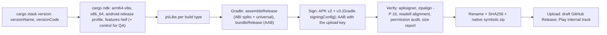

# 06: Build, release and distribution

| | |
|---|---|
| **Version** | 1.0 draft, 2026-10-13 |
| **Extends** | Upstream `docs/releasing.md` (release branch, draft GitHub Release, `release` environment secrets, `SHA256SUMS.txt`) |
| **Implements** | BR-01, BR-02, BR-12, FR-UPD-*, NFR-COMP-02, NFR-SEC-07, NFR-SEC-08, NFR-COMPL-* |

---

## 1. Channels and artifacts

| Artifact | Channel | Who installs it |
|---|---|---|
| `photocraft-<v>-android-arm64-v8a.apk` | GitHub Release, getartcraft.com | Almost all phones, tablets and ARM Chromebooks |
| `photocraft-<v>-android-x86_64.apk` | GitHub Release, getartcraft.com | Intel and AMD Chromebooks, emulators |
| `photocraft-<v>-android-universal.apk` | GitHub Release, getartcraft.com | Anyone unsure of their device (both ABIs; larger) |
| `photocraft-<v>-android.aab` | Google Play (uploaded by CI to the internal track) | Play users (Play generates device-specific APKs) |
| `photocraft-<v>-android-native-symbols.zip` | GitHub Release (maintainers) | Symbolicating crash tombstones |
| `SHA256SUMS.txt` lines for every Android file | GitHub Release (existing file) | Verification |
| `photocraft-qa-<v>-android-*.apk` | CI artifacts only, **never published** | QA automation (control server, FR-QA-01) |

The naming follows the existing pattern (`photocraft-<version>-<platform>-<arch>.<ext>`) in `docs/releasing.md`.

---

## 2. Build pipeline



**Verification steps.** Every one fails the job:

1. `apksigner verify --print-certs` passes, and the certificate SHA-256 equals the published fingerprint.
2. `zipalign -c -P 16 -v 4` passes, and every `.so` has 16 KB-aligned `LOAD` segments (`llvm-readelf -l`).
3. `aapt2 dump permissions` on the release APK lists **no** permissions. A QA APK may list only `INTERNET`.
4. `aapt2 dump badging` shows `targetSdkVersion:'36'`, `minSdkVersion:'29'`, the expected `versionCode` and no
   `debuggable`.
5. The size report (per ABI, universal, AAB) is compared with the previous release; growth over 5% raises a warning
   (NFR-SIZE-03).

---

## 3. Versioning

- **`versionName`** is the workspace version, exactly as `cargo xtask version` prints it (`0.8.2`, `0.9.0-rc.1`).
- **`versionCode`** is computed from it. It must increase with every release and be identical across ABIs. Play
  derives per-device APKs from the AAB, and GitHub users install one APK.

```text
versionCode = MAJOR × 10,000,000 + MINOR × 10,000 + PATCH × 100 + STAGE
STAGE = 99 for a final release, N for "-rc.N" (1 ≤ N ≤ 98)
Limits: MINOR ≤ 999, PATCH ≤ 99, MAJOR ≤ 209 (Android's maximum versionCode is 2,100,000,000)
```

| Version | versionCode |
|---|---|
| 0.8.2 | 80,299 |
| 0.9.0-rc.1 | 90,001 |
| 0.9.0 | 90,099 |
| 1.0.0 | 10,000,099 |
| 1.12.3 | 10,120,399 |

`cargo xtask android version-code` implements the formula. It refuses versions outside the limits and pre-release
labels other than `rc.N`. Unit tests cover the ordering (an rc sorts before its final release; a final sorts before
the next patch).

---

## 4. Signing (decision D-08)

| Topic | Plan |
|---|---|
| **App signing key** | One RSA 4096 key in a PKCS#12 keystore, valid for 30+ years, generated offline. It signs every GitHub and website APK (APK Signature Scheme v2 and v3; v1 is unnecessary with minSdk 29) |
| **Play App Signing** | **Recommended:** upload the *same* app signing key to Play App Signing (the "export and upload a key from a Java keystore" option), and use a separate **upload key** for AAB uploads. Then Play-installed and GitHub-installed copies share one certificate, so users can switch channels and update without uninstalling or losing data |
| **Alternative** | Let Google generate the Play app signing key. Simpler, but GitHub APKs and Play APKs then have different certificates: a user must uninstall (and lose app data) to switch channels. Document this clearly if chosen |
| **Key rotation** | A rotation lineage (APK Signature Scheme v3.1, supported on recent Android versions) is the fallback if the key is ever compromised; Play also supports a key upgrade for new installs. Rehearse the procedure once in a test project |
| **Backups** | Two offline encrypted copies (for example a hardware-encrypted USB drive in two locations) plus a password manager entry. Losing the app signing key without Play App Signing makes updates impossible |
| **CI secrets** (repository environment `release`, limited to the `release` branch, as for the Apple and Windows certificates) | `ANDROID_SIGNING_KEYSTORE` (base64 PKCS#12), `ANDROID_SIGNING_KEYSTORE_PASSWORD`, `ANDROID_SIGNING_KEY_ALIAS`, `ANDROID_SIGNING_KEY_PASSWORD`, `ANDROID_UPLOAD_KEYSTORE`, `ANDROID_UPLOAD_KEYSTORE_PASSWORD`, `ANDROID_UPLOAD_KEY_ALIAS`, `ANDROID_UPLOAD_KEY_PASSWORD`, `PLAY_SERVICE_ACCOUNT_JSON` (Play Developer API, scoped to this app) |
| **Missing secrets** | Unlike desktop artifacts, an unsigned APK cannot be installed. When signing secrets are missing, the Android job **does not attach** APKs to the release and emits `::warning::` (upstream convention). QA and debug builds use a CI debug key |
| **Published fingerprint** | The SHA-256 of the app signing certificate is published in the README, on getartcraft.com and in `docs/android.md`, so users and third-party updaters can verify downloads |

---

## 5. CI/CD

### 5.1 Pull-request workflow (`.github/workflows/android.yml`)

| Job | Runs | Purpose |
|---|---|---|
| `check` | Every PR and every push to `main` | `cargo xtask android check`: `cargo check --locked` for the app and L0–L6, for both Android targets. The **"never break Android"** gate (NFR-MAINT-01) |
| `qa-apk` | PRs touching Android, UI, engine or packaging paths; every push to `main` | Builds the QA APK (control server on) and uploads it as a workflow artifact |
| `smoke` | After `qa-apk`; emulator matrix API 29 and 36, `x86_64`, KVM acceleration | Installs the QA APK, forwards the control port, runs `smoke.sh` (open a sample, run commands, save, screenshot, scan logcat for panics) |
| `policy` | With `qa-apk` | Builds a release-configured APK signed with the debug key and runs the §2 verifications (permissions, alignment, target SDK) |

```yaml
# Illustrative only: pin every action by commit SHA (NFR-SEC-07).
name: Android
on:
  pull_request:
  push:
    branches: [main]
permissions:
  contents: read
jobs:
  check:
    runs-on: ubuntu-24.04
    steps:
      - uses: actions/checkout@<sha>
      - run: rustup target add aarch64-linux-android x86_64-linux-android
      - run: cargo xtask android check
  qa-apk:
    needs: check
    runs-on: ubuntu-24.04
    steps:
      - uses: actions/checkout@<sha>
      - uses: actions/setup-java@<sha>
        with: { distribution: temurin, java-version: "17" }
      - run: packaging/android/ci-setup.sh          # pinned SDK 36, build-tools, NDK r28.x, cargo-ndk
      - run: packaging/android/package.sh --build-type qa
      - uses: actions/upload-artifact@<sha>
        with: { name: photocraft-android-qa, path: dist/android/*.apk }
  smoke:
    needs: qa-apk
    runs-on: ubuntu-24.04
    strategy:
      matrix: { api: [29, 36] }
    steps:
      - uses: actions/checkout@<sha>
      - uses: actions/download-artifact@<sha>
        with: { name: photocraft-android-qa, path: dist/android }
      - run: packaging/android/ci-emulator.sh ${{ matrix.api }}
      - run: packaging/android/smoke.sh dist/android/photocraft-qa-*-x86_64.apk
```

### 5.2 Release integration (decision D-11)

The upstream release workflow delegates everything to `storytold/craft-common-actions/.github/workflows/release.yml`
(tracked at `@main` and shared by all Crafting Apps).

| Option | How | Pros | Cons |
|---|---|---|---|
| **A: shared workflow** (recommended long term) | Add an opt-in `android` job to the shared workflow (inputs: app directory, ABIs, Play track). It uploads to the same draft release | One pipeline; reusable by the other Crafting Apps (BO-5) | Needs org-level review; changes affect every app |
| **B: local workflow first** (recommended for v1.0) | `android-release.yml` in `storytold/photocraft`, triggered by `workflow_run` when "Release" completes on `release`. It builds, signs and runs `gh release upload` into the draft; `environment: release` | Independent; no cross-repo coordination before G3 | Two workflows to keep in step; must handle "draft not found" |

Plan: B for G2 and G3, then move to A after v1.0 if the other Crafting Apps adopt Android.

### 5.3 Play upload

After the GitHub draft is built, CI uploads the AAB to the Play **internal** track through the Play Developer API.
Use the Gradle Play Publisher plugin or a pinned action; the service account is limited to this app. Promotion to
closed, open or production tracks is **manual** in Play Console (§8).

---

## 6. Distribution channels

### 6.1 GitHub Releases and getartcraft.com (APK): primary at launch

- **Install guide** (README, website, `docs/android.md`):
  1. Download the APK for your device (or the universal one).
  2. Optionally check the SHA-256 against `SHA256SUMS.txt`.
  3. Open the file and allow "Install unknown apps" for the browser or file manager when Android asks.
  4. Updates install over the previous version.
- **Signature verification:** publish the certificate fingerprint (§4). Advanced users can run
  `apksigner verify --print-certs` or a verifier app.
- **Developer verification** (C-04, NFR-COMPL-08): before the first public APK, register the developer identity, the
  package name `ai.storyteller.photocraft` and the signing certificate in the Android Developer Console. A Play
  Console account may already cover the identity part; confirm the current process and any fee. Enforcement on
  certified devices began around 2026-09-30 in Brazil, Indonesia, Singapore and Thailand and expands globally in
  2027. Without registration, users in those regions would have to use adb or Android's "advanced flow".
- **Updates:** there is no in-app updater (no network permission). Users follow the GitHub release feed or a
  third-party updater app pointed at the repository's releases. Every release keeps the same certificate (FR-UPD-02).

### 6.2 Google Play (AAB)

| Step | Detail |
|---|---|
| Account | **Organization account** (recommended; D-12): verified organization identity, which needs a D-U-N-S number. New *personal* accounts (created after 2023-11-13) must run a closed test with ≥ 12 testers for 14 consecutive days before production access; organization accounts are exempt |
| App creation | Package `ai.storyteller.photocraft`; free; category Photography (or Art & Design); contact email; website |
| App content | Privacy policy URL (required); Ads: none; App access: everything available without login; Content rating (IARC questionnaire; expected "Everyone" or the equivalent); Target audience 13+ (not designed for children); Data safety: no data collected or shared; financial, health, news and government declarations: none |
| Store listing | §7 |
| Tracks | Internal (team, every release) → Closed (beta testers from Discord, G2) → Open (optional) → Production with staged rollout (§9) |
| Pre-launch report | Must show no crashes and no accessibility errors beyond the known screen-reader gap |
| Compliance | Target API 36; 16 KB alignment; 64-bit; Data safety; annual target-SDK bump before the next 31 August deadline (NFR-COMPL-*) |
| Vitals | Monitor user-perceived crash and ANR rates against the thresholds (NFR-STAB-01, NFR-STAB-02); native symbols are uploaded with each AAB |

### 6.3 F-Droid (optional, after v1.0; D-07)

- **Fit:** FOSS licence, no tracking, no network, no Google Play services dependency (NFR-COMP-04). The AndroidX
  libraries are Apache-2.0.
- **Build:** the F-Droid build server must build from source: a recipe in `fdroiddata` with rustup, the pinned NDK
  and cargo-ndk, as a prebuild step.
- **Reproducible builds (recommended):** F-Droid can then publish the APK signed with the upstream key. That gives one
  certificate across F-Droid, GitHub and Play, and the build is an official one under the brand licence.
- **Brand assets:** the ArtCraft marks are not free (C-05). An F-Droid-signed (non-reproducible) build would either
  strip them with a build flag (required for non-official builds) or carry F-Droid's "non-free assets" anti-feature.
  Reproducible builds avoid both.
- **Fonts:** craft-fonts are OFL, which is acceptable.

### 6.4 Other stores

| Store | Recommendation |
|---|---|
| Samsung Galaxy Store | Could, after v1.0: strong overlap with S Pen and DeX users (P1). Uses the same APK; its own listing and review |
| Amazon Appstore | Not applicable: Amazon ended its Appstore on Android devices in 2025 |
| Huawei AppGallery and others | Not planned |

---

## 7. Store listing rules (BR-10, NFR-COMPL-06)

- **Title:** "PhotoCraft" or "PhotoCraft: PSD Photo Editor" (≤ 30 characters). **Never** use "Photoshop" or "Adobe"
  in the title, icon, developer name or keywords.
- **Short description (≤ 80 characters):** for example "Open-source layered photo editor. Real PSD files. Offline,
  no account."
- **Full description:** features ("opens and saves PSD and PSB files with layers, masks, adjustment layers and type"),
  honest status ("early alpha"; known gaps, including no screen-reader support yet), and a trademark notice: "Adobe
  and Photoshop are trademarks of Adobe Inc. PhotoCraft is an independent open-source project, not affiliated with or
  endorsed by Adobe." Legal reviews the final text.
- **Graphics:**
  - 512 × 512 icon, from `assets/app-icon/photocraft.svg` (MIT/Apache).
  - 1024 × 500 feature graphic.
  - Phone, 7-inch, 10-inch and Chromebook screenshots, rendered through the QA control channel (`ui.screenshot`) on
    public-domain art, like the desktop README.
- **Brand:** ArtCraft marks appear only in the official listing, unmodified (C-05). A fork's listing must not use them.
- **Languages:** English at launch; translate the listing into the top UI languages (Should).

---

## 8. Release process (additions to `docs/releasing.md`)

1. **Bump the version** on `main` (`cargo xtask version set …`), as today. CI checks that it maps to a valid
   versionCode.
2. **Push to `release`.** The shared workflow builds desktop and web; the Android release job (§5.2) builds, signs and
   verifies the APKs and AAB, attaches the APKs, checksums and symbols to the draft, and uploads the AAB to Play
   internal.
3. **Check:**
   - Install the arm64 APK on one tablet and one phone, and the x86_64 APK on a Chromebook or emulator.
   - Run the 10-minute smoke checklist ([07](07-test-qa-plan.md) §5.9).
   - Install from the Play internal track.
   - Read the pre-launch report.
4. **Add the Android notes** to the draft: what changed for Android, known issues, and the certificate fingerprint.
5. **Publish the draft** (GitHub). The APKs are public, and the website download page updates (link to the latest
   release, or the website mirrors the files).
6. **Play:** promote the build to the closed track (beta) or to production with staged rollout (§9).

Pre-releases (`-rc.N`) go to GitHub as pre-releases and to Play closed testing only.

---

## 9. Rollout, monitoring and hotfixes

| Stage | Exposure | Duration | Proceed when |
|---|---|---|---|
| Internal | Team | Every release | Smoke checklist passed |
| Closed beta | Discord beta group (≥ 12 testers) | ≥ 14 days for the first release (personal-account rule) or ≥ 3 days | No S1 defects; crash rate < 2% in the beta |
| Production 10% | Play | 2 days | Crash < 1.5%, ANR < 0.5%, no data-loss reports |
| Production 50% | Play | 2 days | Same, trending to targets |
| Production 100% | Play | — | Vitals within the NFR targets |

- **Halt criteria:** a confirmed data-loss defect; crash rate above 2% for the new version; ANR above 1%; a security
  issue.
- **Hotfix:** a patch version (`x.y.z+1`) through the normal release branch. GitHub users get it on publication; on
  Play, resume rollout with the fix. Halting a Play rollout does not affect GitHub users, so publish a fixed APK
  promptly.
- **Support policy:** only the latest release is supported while upstream is in alpha. Android 10+ is supported;
  raising `minSdk` happens only at a minor or major release, announced one release in advance.
