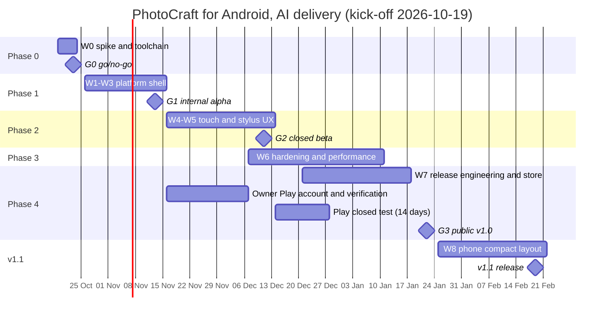

# 08: Roadmap, work breakdown and estimates

| | |
|---|---|
| **Version** | 1.0 draft, 2026-10-13 |
| **Assumed kick-off** | Monday 2026-10-19 (A-11) |
| **Units** | Agent-hours (ranges), upstream's own calibration unit. **AI agents build everything (D-14)**; see [11](11-ai-delivery-plan.md). The calendar depends on agent parallelism, usage limits and the owner's availability. Device testing and Play's 14-day closed test do not compress |

---

## 1. Phases and gates

| Phase | Goal | Calendar | Ends with |
|---|---|---|---|
| Phase | Goal | Calendar (AI delivery) | Ends with |
|---|---|---|---|
| **0: feasibility and decisions** | Prove the stack on the emulator and the owner's device; measure; take the founding decisions | 1 week | **G0** go/no-go (2026-10-23) |
| **1: platform shell MVP** | A real Android app: files, lifecycle, GPU fallback, fonts, memory, packaging, CI | 3 weeks (waves W1–W3) | **G1** internal alpha (2026-11-13) |
| **2: touch and stylus UX** | Usable for real work on tablets; phones basic | 4 weeks (W4–W5) | **G2** closed beta (2026-12-11) |
| **3: hardening and performance** | Device matrix, performance budgets, stability, accessibility baseline, size | 5 weeks (W6, overlaps Phase 4) | — |
| **4: release and distribution** | Signing, release CI, store setup, closed test, verification registration | 4 weeks (W7; owner tasks H-05 to H-10) | **G3** public v1.0 (2027-01-22) |
| **5: phone layout (v1.1)** | The Compact workspace, if D-02 deferred it; printing; feedback fixes | 4 weeks (W8) | **v1.1** (2027-02-19) |

Notes:

- The owner should start the Play account and verification (H-05, H-06) early, in Phase 2, because identity checks
  take days.
- Late-December holidays affect the owner's availability for device checks; they are treated as buffer.

---

## 2. Gate decisions

| Gate | Decision makers | Go criteria (summary; full list in [07](07-test-qa-plan.md) §6) | No-go options |
|---|---|---|---|
| G0 | Owner (lead agent presents the spike report) | No unresolvable blockers in the spike; upstream agrees to the approach (A-01) if D-01 = official; decisions D-01 to D-06 and D-10 taken | Re-scope (for example tablets only), delay, or switch to option E (fork) or C (PWA, interim) |
| G1 | Owner (gate report from the lead and QA agents) | Files, lifecycle and GPU fallback solid on the emulator and the owner's device; CI green | Extend Phase 1; keep the Phase 2 scope |
| G2 | Owner, after their own device check and usability round R2 | Tablet workflows pass R2; no open S1 | Extend the beta; cut Should items |
| G3 | Owner (submits to the stores) | All Must requirements; vitals targets in the beta; listing approved | Delay the public launch; release on GitHub only |

---

## 3. Work breakdown structure and estimates

### Phase 0: feasibility and decisions

| WBS | Work package | Hours | Output |
|---|---|---|---|
| 0.1 | Toolchain setup; Gradle and GameActivity skeleton; version pairing check | 8–16 | A buildable empty app |
| 0.2 | Compile the workspace for `aarch64-linux-android` and `x86_64-linux-android`; fix `cfg` gaps and dependency issues | 16–40 | A list of blockers with fixes |
| 0.3 | `PhotocraftApp` running with stub `Services` on 3 physical devices and the emulator | 16–32 | A working prototype |
| 0.4 | Measurements and spike report: `.so` and APK size, start-up, RSS, GPU features and limits, touch, stylus and IME reachability | 8–16 | Spike report |
| 0.5 | Upstream RFC (issue and Discord) and decision workshop: D-01 to D-06, D-10 | 4–8 | Signed decisions |
| | **Subtotal** | **52–112** | |

### Phase 1: platform shell MVP

| WBS | Work package | Hours | Requirements |
|---|---|---|---|
| 1.1 | App crate skeleton: `android_main`, logging, panic hook, build profile, empty host build | 12–24 | UC-01, NFR-STAB-03 |
| 1.2 | Extract the shared shell crate from the desktop app (import, export, save worker, recovery wiring, GPU marker, crash guard, logging core, control server) | 16–32 | UC-02 |
| 1.3 | JNI bridge: isolated `unsafe` module, typed API, Kotlin `PlatformBridge`, tests | 24–48 | NFR-STAB-06, NFR-SEC-06 |
| 1.4 | App storage: preferences, presets, recovery store, eframe persistence, `TMPDIR` | 8–16 | FR-SET-01 to 03 |
| 1.5 | SAF open (single and multiple), descriptor reading, display names, MIME mapping, document origin (UC-03) | 24–40 | FR-FIO-01, 04, 13, 14 |
| 1.6 | Save, Save As and Export; persisted grants; safe write; Recents | 24–40 | FR-FIO-05 to 08, 11 |
| 1.7 | Folder trees for batch and export-layers | 12–24 | FR-FIO-10 |
| 1.8 | Share out; `VIEW`, `EDIT`, `SEND` and `SEND_MULTIPLE` in; Photo Picker; MediaStore export | 20–40 | FR-FIO-02, 03, 08, 09 |
| 1.9 | Lifecycle: surface loss and recovery, autosave flush on pause, recovery after process death, exit reasons | 24–40 | FR-LC-02 to 07 |
| 1.10 | GPU plan chain with crash marker and deny-list; float-format feature check | 16–32 | NFR-STAB-04 |
| 1.11 | Memory: physical memory on Android, mobile budget, trim-memory purge | 12–24 | UC-05, NFR-STAB-05 |
| 1.12 | Fonts (`SystemFonts`, CJK, user fonts), locale, theme, insets, back callback | 20–40 | FR-TXT-*, FR-UI-02, 07, FR-LC-06 |
| 1.13 | Clipboard (images and text) | 12–24 | FR-CLP-02 |
| 1.14 | Packaging: manifest, adaptive icon, splash, build types (debug, QA, release), `package.sh` | 12–24 | FR-LC-01, FR-QA-01 |
| 1.15 | CI: Android check gate, QA APK, emulator smoke through the control channel | 16–32 | NFR-MAINT-01 |
| | **Subtotal** | **252–480** | |

### Phase 2: touch and stylus UX

| WBS | Work package | Hours | Requirements |
|---|---|---|---|
| 2.1 | Gesture layer: pan, pinch, rotate, tap gestures, kinetic pan, arbitration with tools | 24–48 | FR-INP-02, 03, UC-08 |
| 2.2 | Touch shortcut (ring and key bar), stylus-button mapping, modifier merging | 16–32 | FR-INP-05, 06 |
| 2.3 | UI Density (Touch tokens), long press as secondary click, flyouts, hover audit and alternatives | 32–64 | FR-UI-01, 05, FR-INP-04, UC-09 |
| 2.4 | Text entry: soft keyboard, IME composition, native text-entry fallback | 24–48 | FR-INP-11 |
| 2.5 | Stylus bridge: pressure, tilt, orientation, eraser, buttons, hover, historical samples, palm rejection | 32–64 | FR-INP-06 to 08, UC-07 |
| 2.6 | Touch workspace (tablets), start screen, transform commit and cancel buttons, dialog fitting | 24–48 | FR-UI-03, 06, 08, UC-10 |
| 2.7 | Physical keyboard, mouse and trackpad; DeX, ChromeOS and desktop-windowing polish | 8–16 | FR-INP-09, 10, FR-LC-08 |
| 2.8 | First-run cards and the touch help page | 8–16 | [05](05-ux-touch-design.md) §13 |
| | **Subtotal, tablet-first** | **168–336** | |
| 2.9 | Phone Compact workspace: drill-down menu, tools drawer, bottom sheets, condensed options bar, full-screen dialogs | 80–160 | FR-UI-04 (v1.1 per D-02) |

### Phase 3: hardening and performance

| WBS | Work package | Hours | Requirements |
|---|---|---|---|
| 3.1 | Device-matrix testing; GPU driver workarounds; deny-list entries | 40–80 | NFR-COMP-03, NFR-STAB-04 |
| 3.2 | Mobile performance: budgets, profiling (Perfetto, simpleperf), fixes | 40–100 | NFR-PERF-* |
| 3.3 | Memory stress; large-document behaviour per RAM tier | 16–40 | NFR-STAB-05, FR-FIO-04 |
| 3.4 | Stability: crash and ANR triage, `panic_hunt` on devices, lifecycle torture fixes | 24–48 | NFR-STAB-*, NFR-DATA-* |
| 3.5 | Accessibility baseline; TalkBack investigation and upstream proposal | 8–24 | NFR-A11Y-* |
| 3.6 | Localization of Android-only strings; per-app language; RTL check | 8–16 | FR-L10N-* |
| 3.7 | Binary size optimization (profile tuning, symbol handling, font decision D-09) | 8–16 | NFR-SIZE-* |
| | **Subtotal** | **144–324** | |

### Phase 4: release and distribution

| WBS | Work package | Hours | Requirements |
|---|---|---|---|
| 4.1 | Signing keys, Play App Signing, secrets, backups | 4–8 | NFR-SEC-08, D-08 |
| 4.2 | Release CI: APK splits, universal APK, AAB, checksums, symbols, Play internal upload | 16–32 | BR-12 |
| 4.3 | Play Console: listing, screenshots through the control channel, Data safety, content rating, privacy policy | 12–24 | BR-02, NFR-COMPL-* |
| 4.4 | Closed test programme and feedback loop | 8–16 | [06](06-build-release-distribution.md) §9 |
| 4.5 | Developer verification registration (non-Play distribution) | 2–6 | NFR-COMPL-08 |
| 4.6 | Website and GitHub release notes; install guide; `docs/android.md` | 4–8 | NFR-MAINT-05 |
| | **Subtotal** | **46–94** | |
| 4.7 | F-Droid recipe and reproducible build (optional, after v1.0) | 16–40 | D-07 |

### Totals

| Scope | Agent-hours | With 15% lead-agent overhead (briefs, integration, reviews, gate reports) |
|---|---|---|
| **Tablet-first v1.0** (Phases 0–4, without 2.9 and 4.7) | **662–1,346** | **≈ 760–1,550** |
| Plus the phone layout (2.9) | 742–1,506 | ≈ 855–1,730 |
| Plus F-Droid (4.7) | +16–40 | +18–46 |

The owner's own time (decisions, accounts, device checks, submissions) is separate: about 20–35 hours
([11](11-ai-delivery-plan.md) §2).

---

## 4. Staffing scenarios

There are no human engineers (D-14). The roles are AI agents plus the owner ([11](11-ai-delivery-plan.md) §1).
The scenarios differ in concurrency and in the owner's availability.

| Scenario | Agents and owner | Tablet-first v1.0 | Plus phone layout |
|---|---|---|---|
| Lean | 1 agent session at a time; owner a few hours a week | ≈ 24–30 weeks | +6–8 weeks |
| **Planned** | 2–3 concurrent agent sessions; owner about 1 h a day plus gate sessions | **≈ 14 weeks (G3 around 2027-01-22)** | **+4 weeks (v1.1 around 2027-02-19)** |
| Fast | 4–5 concurrent sessions (needs a second build machine or cloud sessions); owner daily | ≈ 10–12 weeks (bound by device testing, the 14-day closed test and Play review) | +3 weeks |

**What agents are weakest at, and how the plan compensates**

| Weakness | Compensation |
|---|---|
| Judging feel: stylus latency, gesture comfort, touch ergonomics | The owner's device checks and usability rounds with real users at G1, G2 and G3 |
| Real GPU drivers and real devices (emulators differ) | QA agent runs suites over adb on the owner's device; beta testers cover more devices; optional device farm |
| Errors that only an independent eye catches | Implementer ≠ reviewer; a second review for high-risk areas; CI gates |
| Anything involving accounts, money, keys or public posting | Owner-only tasks H-01 to H-12 |

---

## 5. Critical path

1. **G0 spike:** compile the graph, GameActivity pairing, rendering on devices.
2. **JNI bridge (1.3), then SAF open and save (1.5, 1.6), then lifecycle and autosave (1.9).** This is G1-critical.
3. **Text entry (2.4) and the gesture layer (2.1).** These are the highest-uncertainty UX items, and G2-critical.
4. **Device hardening (3.1) and performance (3.2).** These carry the most variance.
5. **Play closed test.** The 14-day clock applies to a personal account; start it at G2 in any case to collect
   feedback. Store review must also pass before G3.
6. **Owner tasks on the path:**
   - H-01: Q-01 answer (blocks G0).
   - H-03: a device for the spike (blocks G0).
   - H-05 and H-06: Play account and developer verification. Start in Phase 2; they block G3.
   - H-07: 12 testers if the account is personal (blocks G3).

**Parallel streams.** Packaging and CI (1.14, 1.15), fonts and locale (1.12) and clipboard (1.13) run in parallel
with the bridge work. The touch UX design for Phase 2 is drafted by an agent during Phase 1, from
[05](05-ux-touch-design.md).

---

## 6. Cost summary

See [01](01-business-requirements.md) §14 and [11](11-ai-delivery-plan.md) §8.

| Scope | Cost |
|---|---|
| Engineering | No salaries; AI usage for about 760–1,550 agent-hours (tablet-first, including overhead), reported per gate |
| Devices and services | The owner's device; a stylus tablet recommended (about US$300–900); Play US$25; verification per Google's terms; optional device farm |
| Ongoing | Agent sessions for the daily upstream sync, yearly target-SDK bumps, device issues, store compliance; owner release approvals |

---

## 7. After v1.0 (candidate roadmap)

| Item | Value | Effort (rough) |
|---|---|---|
| Phone Compact layout (if deferred) | Persona P3 | 80–160 h |
| PrintManager printing (FR-FEAT-08) | Completeness | 16–32 h |
| Camera capture (FR-FEAT-07) | Mobile convenience | 8–16 h |
| AVIF and other formats through the platform decoder (FR-FEAT-04) | Phone galleries | 16–32 h |
| TalkBack (AccessKit Android in egui; upstream contribution) | Accessibility, education | 80–200 h, depending on the upstream state |
| Wide-gamut (P3) and HDR canvas | Colour professionals | 60–120 h |
| Reusable Android shell in `craft-libs` for the other Crafting Apps (BO-5) | Ecosystem | 40–80 h, plus per-app 40–80 h |
| Galaxy Store listing | S Pen and DeX reach | 4–8 h |
| Motion prediction and lower-latency inking | Stylus feel | 24–48 h |
